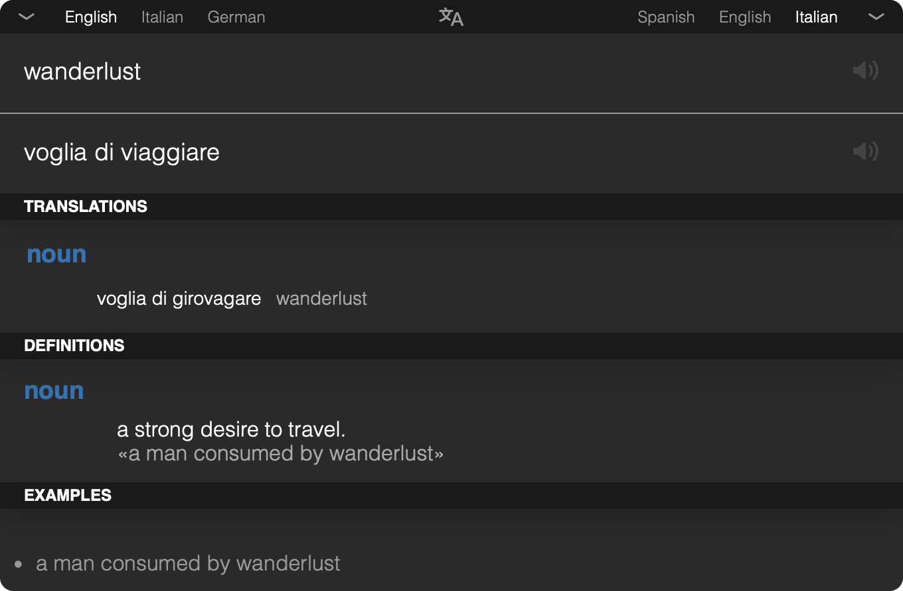

<div align="center">


# Transee

**Translate without breaking your flow.**

A compact translation bar for macOS and Windows.<br />
One shortcut. Your words. A world of meaning.

[](https://github.com/alessioforte/transee/releases)
[](https://github.com/alessioforte/transee/actions/workflows/release.yml)
[](#download)
[](https://v2.tauri.app)
[](LICENSE)

**[Download](https://github.com/alessioforte/transee/releases)**
· [Features](#why-transee)
· [Keyboard shortcuts](#keyboard-shortcuts)
· [Build from source](#development)
· [Report an issue](https://github.com/alessioforte/transee/issues)

<br />



<p><sub>Captured from the running macOS app · English → Italian · Dictionary cards</sub></p>

</div>

## Why Transee?

Look up a word, check a meaning, or translate a sentence without leaving your
desktop workflow. Transee lives in your menu bar or system tray and brings
Google Translate into a focused, keyboard-friendly window.

- **Always a shortcut away.** Press `Ctrl+Alt+T` to bring up the bar; customize
  the shortcut in Preferences.
- **More than a translation.** Explore alternative translations, definitions,
  synonyms, and usage examples in dictionary cards, when Google provides them.
- **Hear the words.** Play pronunciation audio for the original text and its
  translation in supported languages.
- **Your languages, within reach.** Keep favorite language choices handy and
  swap the translation direction from the keyboard.
- **Light or dark.** Switch Dark mode in Preferences to update every window
  instantly. Your choice is remembered across launches.
- **At home on your desktop.** The bar opens on the display under your pointer
  and follows the active macOS Space. Hide it when you're done; it stays ready
  in the tray.
- **A small, open-source stack.** Built with Tauri 2, Rust, React, and TypeScript,
  using the system webview rather than bundling Chromium.

Dictionary cards load independently, so the main translation does not wait
for them. Their availability depends on the query and language pair.

## Download

Browse **[GitHub Releases](https://github.com/alessioforte/transee/releases)**
for available installers and release notes.

> [!NOTE]
> The `main` branch contains the Tauri-based v3 rewrite. Older published
> releases, including v2.1.0, use Electron and do not include the new features
> described here. Build from source to try v3 until its installers are published.

The v3 release workflow builds a universal **macOS `.dmg`** for Apple Silicon
and Intel, and a **Windows x64 `.exe`** installer.

> [!IMPORTANT]
> The current v3 workflow produces unsigned installers, and macOS builds are
> not notarized. Gatekeeper or Windows SmartScreen may display a warning.

Once installed, launch Transee, press **`Ctrl+Alt+T`**, choose your languages,
and start typing. Open the tray menu for Preferences or the Welcome Guide.
Translation and dictionary lookups require an internet connection; queries
are sent to Google Translate.

## Keyboard shortcuts

| Shortcut | Action |
| --- | --- |
| `Ctrl+Alt+T` | Show and focus the translation bar; customizable in Preferences. |
| `Ctrl+I` | Swap source and target languages. |
| `Ctrl+P` | Play the source text's pronunciation. |
| `Ctrl+Alt+P` | Play the translation's pronunciation. |
| `Esc` | Dismiss suggestions first, then hide the bar. |

These shortcuts use **Control** on both platforms, including macOS.

## Development

### Prerequisites

- **Node.js 24** is recommended and matches the release workflow.
- **[Rust](https://rustup.rs)** stable.
- **macOS:** Xcode command line tools. **Windows:** MSVC build tools and WebView2.

```bash
git clone https://github.com/alessioforte/transee.git
cd transee
npm ci
npm start
```

`npm start` launches the full Tauri app with the Vite dev server. `npm run dev`
starts only the frontend, without the native desktop integration.

```bash
npm run typecheck  # Strict TypeScript checks
npm test           # Offline frontend tests
npm run build      # Production frontend build
```

<details>
<summary>Native checks and development windows</summary>

```bash
cargo check --locked --manifest-path src-tauri/Cargo.toml
cargo test --locked --manifest-path src-tauri/Cargo.toml
```

On macOS, `TRANSEE_DEV_WINDOWS=1 npm start` also opens the About, Preferences,
and Welcome windows at launch. Otherwise, open them through the tray menu.

Hide-on-blur is disabled in debug builds, so the bar stays visible while you
work with developer tools.

</details>

### Packaging

```bash
npm run package  # Build for the host architecture
```

For a universal macOS build, install **both** Rust targets first:

```bash
rustup target add aarch64-apple-darwin x86_64-apple-darwin
npm run package -- --target universal-apple-darwin
```

Host bundles land in `src-tauri/target/release/bundle/`; universal macOS
bundles land in `src-tauri/target/universal-apple-darwin/release/bundle/`.

<details>
<summary>macOS signing and notarization</summary>

Local signing and notarization use Tauri's environment variables:
`APPLE_SIGNING_IDENTITY`, plus either `APPLE_API_*` or
`APPLE_ID` / `APPLE_PASSWORD` / `APPLE_TEAM_ID`. Tauri notarizes as part of the
build when the required credentials and signing identity are configured.

The GitHub workflow does not import certificates or pass signing credentials.
Configure certificate import and signing/notarization secrets before using it
for signed distribution. Never commit credentials.

</details>

### Automated releases

The [release workflow](.github/workflows/release.yml) runs on pushed `v*` tags.
It validates version consistency, runs typechecking and offline tests, and
builds both platforms. A release is published **only after both builds succeed**,
with generated release notes and both installers attached.

<details>
<summary>Maintainer guide: publish a version</summary>

Keep the version aligned in:

- `package.json`.
- `package-lock.json`, including both root version entries.
- `src-tauri/Cargo.toml`.
- The `transee` package entry in `src-tauri/Cargo.lock`.
- `src-tauri/tauri.conf.json`.

Commit and push the workflow and matching version files, then tag that commit.
For example, to release `3.0.0`:

```bash
node .github/scripts/check-release-version.mjs v3.0.0
git tag -a v3.0.0 -m "Release v3.0.0"
git push origin v3.0.0
```

Versions such as `3.1.0-beta.1` / `v3.1.0-beta.1` are marked as prereleases
automatically. Both macOS Rust targets are installed by the workflow, and the
packaged executable is checked for Apple Silicon and Intel architectures.

A failed build does not publish a release. Retry transient failures with
**Re-run failed jobs** in Actions; source fixes need a new commit and version
tag. An upload failure leaves a newly created release as a draft, and reruns
replace matching assets.

Publishing uses the automatic `GITHUB_TOKEN` with `contents: write` only in the
publishing job. No personal access token or additional secrets are required
for unsigned builds.

</details>

### Project structure

<details>
<summary>A quick map of the codebase</summary>

```text
src/
  app/          App bootstrap and window selection
  features/     Translation bar, dictionary cards, settings, and onboarding
  shared/       Reusable UI, hooks, and styles
  platform/     Boundary for Tauri APIs and native commands
  services/     Google Translate clients, parsers, and audio
  stores/       Persisted settings and transient translation state
  types/        Shared TypeScript types
src-tauri/      Rust shell: tray, shortcuts, windows, settings, and HTTP
fixtures/      Recorded Google responses for offline tests
baseline/      Pre-migration UI reference screenshots
.github/       Release workflow and version-validation scripts
```

`index.html` is the single frontend entry; the query string selects the window.
Imports use `@/` for `src/` and `@assets/` for assets. Only `src/platform/`
imports `@tauri-apps/*`; UI and services go through that boundary.

Styling uses CSS Modules and the custom properties in
`src/shared/styles/tokens.css`, with no runtime styling library. Tests check
the derived color tokens to keep the palette consistent.

</details>

### Settings and upgrades

Preferences are stored locally:

- **macOS:** `~/Library/Application Support/com.alessioforte.transee/settings.json`.
- **Windows:** `%APPDATA%\com.alessioforte.transee\settings.json`.

Settings from the previous Electron app (`.../Transee/config.json`) are
imported automatically on first launch.

## Contributing

Found a bug, a missing language, or an idea worth exploring?
[Open an issue](https://github.com/alessioforte/transee/issues) or send a pull
request. Include your OS, app version, and reproduction steps for bug reports,
and run the relevant checks before submitting code changes.

## License

[MIT](LICENSE) · Created by [Alessio Forte](https://github.com/alessioforte).

Transee is an independent project and is not affiliated with or endorsed by
Google. Translation and dictionary data are provided by Google Translate.
